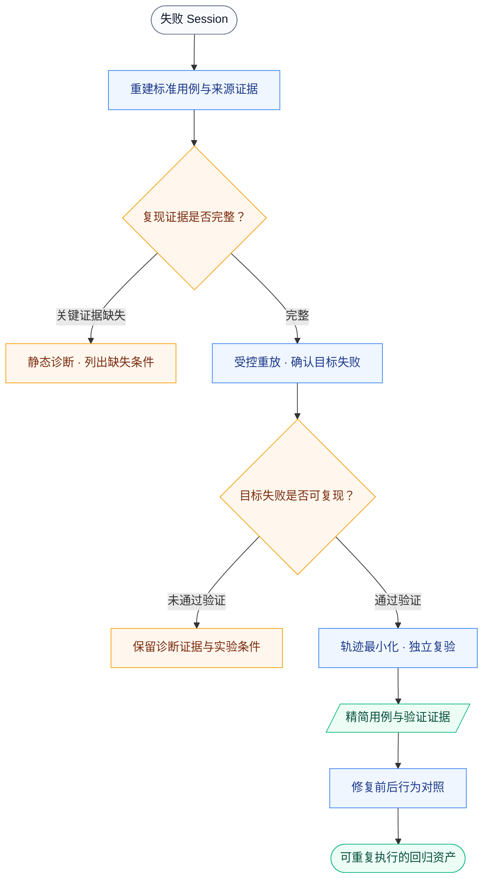
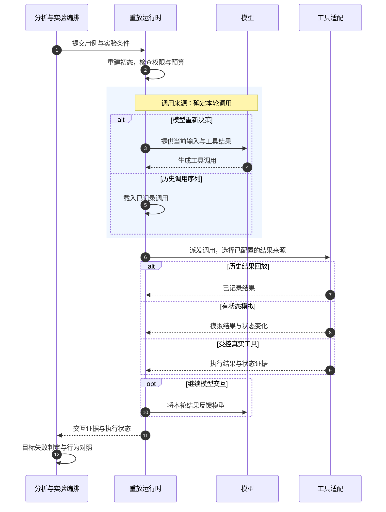

# DSH Case Compiler

> Agent 失败诊断与回归验证插件：通过受控重放与轨迹最小化，从冗长失败 Session 中收敛关键复现条件，辅助问题归因与修复验证。

DSH Case Compiler 面向 Agent 开发中的工具误选、重复调用及交互异常，将失败 Session 转换为可重放、可缩减的标准用例。项目以失败轨迹最小化为核心，贯通请求重建、实验编排、执行控制与修复回归，让一次失败能够成为后续迭代中可持续使用的验证资产。

**个人职责：**独立负责架构设计、核心开发与插件交付，构建从失败重建、受控重放到最小化与回归验证的完整链路。

**技术栈：**TypeScript / Node.js / pnpm Monorepo / DSH / Cordis / Vitest。

## 项目亮点

- **Agent 失败归因：**围绕上下文、工具交互与环境状态重建失败条件，通过保持同一失败的轨迹缩减，帮助开发者缩小排查范围。
- **可组合的重放运行时：**分开控制模型决策与工具执行，支持历史结果、状态模拟和受控真实工具的组合，在复现真实性、实验成本与执行风险之间取得平衡。
- **面向非确定行为的验证设计：**通过重复观测、独立复验和一致的失败判定口径，减少模型随机性对缩减结论的干扰。
- **完整的工程交付：**覆盖插件接入、执行预算、状态隔离、取消恢复与回归用例交付，使分析过程可追溯、结果可复用。

在 **6 类、18 个离线确定性基准 Case** 上，均缩减至预设必要单元，平均单元缩减率达到 **73.6%**。该结果用于衡量离线缩减能力；真实模型与工具执行的验证范围见下文。

## 背景与目标

Agent 的失败通常跨越多轮对话、动态上下文和工具交互。完整日志保留了过程，但关键触发条件仍被大量无关信息掩盖；模型随机性和环境变化又使简单复跑难以形成可靠结论。修复后，开发者还需要确认目标失败是否消失，以及验证所依据的条件是否一致。

项目围绕三个问题展开设计：**如何还原失败、如何收敛条件、如何验证修复**。将原始 Session 重建为有来源证据的用例，在受控实验中减少无关输入，再将精简结果沉淀为可重复执行的回归资产。

### 失败诊断与回归流程

完整性检查决定用例能够进入何种分析阶段；重放、缩减与修复对照使用一致的失败判定，使结论始终对应可核对的实验条件。

## 核心能力与设计思路

### 1. 失败重建与诊断：以实际请求条件作为分析起点

将历史对话、关键上下文、工具定义及交互结果组织为标准用例，保留与原始 Session 的对应关系，使开发者能够追溯模型在失败时看到了什么、调用了什么，以及执行结果如何影响后续行为。

重建过程检查复现条件的完整性：证据充分时进入行为验证，关键条件缺失时明确给出缺失项并保留静态分析能力，防止历史信息失真影响后续缩减。由此为上下文缺失、工具误选和交互异常提供统一的分析起点。

### 2. 失败轨迹最小化：面向模型非确定性的实验设计

围绕明确的目标失败，逐层裁剪无关对话、上下文、工具记录与环境输入，在保持同一失败可复现的前提下收敛关键条件，将长轨迹转化为更易理解和验证的精简用例。

设计上将每次缩减视为一次受控实验：固定失败判定与实验配置，结合重复观测和独立复验评估候选。缩减结论对应当前实验边界内观察到的复现条件，为进一步归因提供依据，不直接等同于唯一根因。

### 3. 可组合重放：分别验证模型决策与工具执行

将“调用如何产生”与“结果如何获得”分开管理。分析工具误选时重新观察模型决策，分析执行异常时核对既定调用及状态变化，让验证结论对应实际观察到的行为。

工具结果支持历史记录、状态模拟与显式接入的真实执行，不同工具可以按分析需求组合配置。通过保留关键交互并控制非关键外部依赖，兼顾复现真实性、实验可控性和执行成本。

时序图示意一次工具交互。两类调用来源共享重放与执行控制能力，结果来源按工具分别配置；模型可以继续基于返回结果形成后续决策。历史序列执行与模型行为复现保留各自的验证口径。

### 4. 状态与执行治理：保持候选实验相互独立

将环境初态、交互依赖及执行前后状态纳入实验管理，为不同候选重建独立起点，避免前一次执行改变后续实验条件。对于依赖前序结果的调用，保留其状态关联，减少无效候选对分析结论的干扰。

真实工具受明确的权限、作用范围和资源预算约束，并支持取消、进度保存与恢复。恢复前重新核对实验条件和剩余预算；出现写入结果不确定或清理异常时保留证据并停止后续执行，避免将执行故障误判为目标失败。

### 5. 修复回归：让分析证据进入后续迭代

将精简用例、失败判定、工具配置、来源证据和验证报告一并交付，在一致条件下比较修复前后的行为。典型失败可以持续保留为回归用例，减少问题交接时的信息丢失和重复排查。

交付过程包含敏感信息处理与产物完整性检查，使失败用例能够被审查、共享和重复使用，让诊断结果持续服务于 Agent 质量改进。

## 架构设计与取舍

系统按接入、编排、领域规则与运行适配划分职责。下图从模块边界展示逻辑架构：实线表示能力调用，虚线表示运行适配遵循核心契约。

```mermaid
flowchart LR
  subgraph ENTRY["接入层"]
    direction TB
    PLUGIN["DSH 插件"]
    CLI["命令入口"]
  end

  subgraph APP["应用编排"]
    ORCH["用例重建<br/>重放与最小化<br/>修复回归与报告"]
  end

  subgraph CORE["领域核心"]
    direction TB
    CASE["用例与依赖约束"]
    FAILURE["目标失败判定"]
    VERIFY["候选缩减与结果验证"]
  end

  subgraph RUNTIME["运行适配"]
    direction TB
    MODEL["模型与宿主适配"]
    TOOL["工具与状态环境"]
    STORE[("进度与回归资产")]
  end

  ENTRY --> APP
  APP --> CORE
  APP --> RUNTIME
  RUNTIME -.->|遵循核心契约| CORE

  classDef module fill:#FFFFFF,stroke:#94A3B8,color:#334155
  classDef orchestration fill:#FFFFFF,stroke:#475569,stroke-width:2px,color:#0F172A
  classDef core fill:#FFFFFF,stroke:#8B5CF6,color:#4C1D95
  classDef storage fill:#FFFFFF,stroke:#64748B,color:#334155
  class PLUGIN,CLI,MODEL,TOOL module
  class ORCH orchestration
  class CASE,FAILURE,VERIFY core
  class STORE storage
  style ENTRY fill:#F8FAFC,stroke:#CBD5E1,color:#334155
  style APP fill:#F1F5F9,stroke:#64748B,color:#0F172A
  style CORE fill:#F5F3FF,stroke:#A78BFA,stroke-width:2px,color:#4C1D95
  style RUNTIME fill:#F8FAFC,stroke:#94A3B8,stroke-dasharray:5 5,color:#334155
```

| 设计取舍                           | 工程价值                                                         |
| ---------------------------------- | ---------------------------------------------------------------- |
| 领域规则与宿主、模型及工具实现解耦 | 核心缩减与判定能力可独立验证和复用，减少外部变化对分析流程的影响 |
| 用例、实验条件与执行结果统一关联   | 保持缩减前后的判定口径一致，使每个结论都有可核对的依据           |
| 实验隔离与执行权限分别管理         | 独立初态保证实验可比较，权限和预算约束实际操作范围               |
| 历史证据与新一轮验证分别记录       | 保留审查与恢复所需信息，避免把已保存的结果当作新的复现证据       |

## 验证结果与范围

| 验证内容               | 已有结果                                                                                                 |
| ---------------------- | -------------------------------------------------------------------------------------------------------- |
| 离线确定性缩减基准     | 覆盖 **6 类、18 个 Case**，均缩减至预设必要单元；各 Case 单元缩减率的算术平均为 **73.6%**                |
| 真实模型与历史结果重放 | 单个 DeepSeek 合成 Case 的目标失败在缩减前 **5/5** 次命中、最终验证 **10/10** 次命中，未执行真实外部写入 |
| 受控文件执行           | 完成限定范围的 Windows 集成验证，覆盖独立初态、文件操作、权限控制、取消及清理异常                        |

离线基准验证缩减与依赖处理；真实模型结果来自预设目标行为的合成实验，验证重放和最小化链路，不代表生产场景中的失败概率或普遍修复效果。

API 交互与模型组合已完成相关接口、离线编排和模拟验证，真实 HTTP 与真实模型组合的端到端验收仍待完成。执行环境面向受信任开发者的用例与工作区，其隔离用于保持实验条件，不替代运行任意不可信代码的安全沙箱。

## 项目价值

- **让失败更易定位：**将完整交互收敛为关键复现条件，帮助开发者聚焦上下文、工具选择和状态依赖中的问题。
- **让实验更易复核：**将模型行为、工具执行与环境变化放入统一的受控验证过程，保留可追溯的实验依据。
- **让修复持续可验证：**把一次失败沉淀为回归资产，连接问题分析、修复对照与后续迭代。

## License

Apache-2.0
