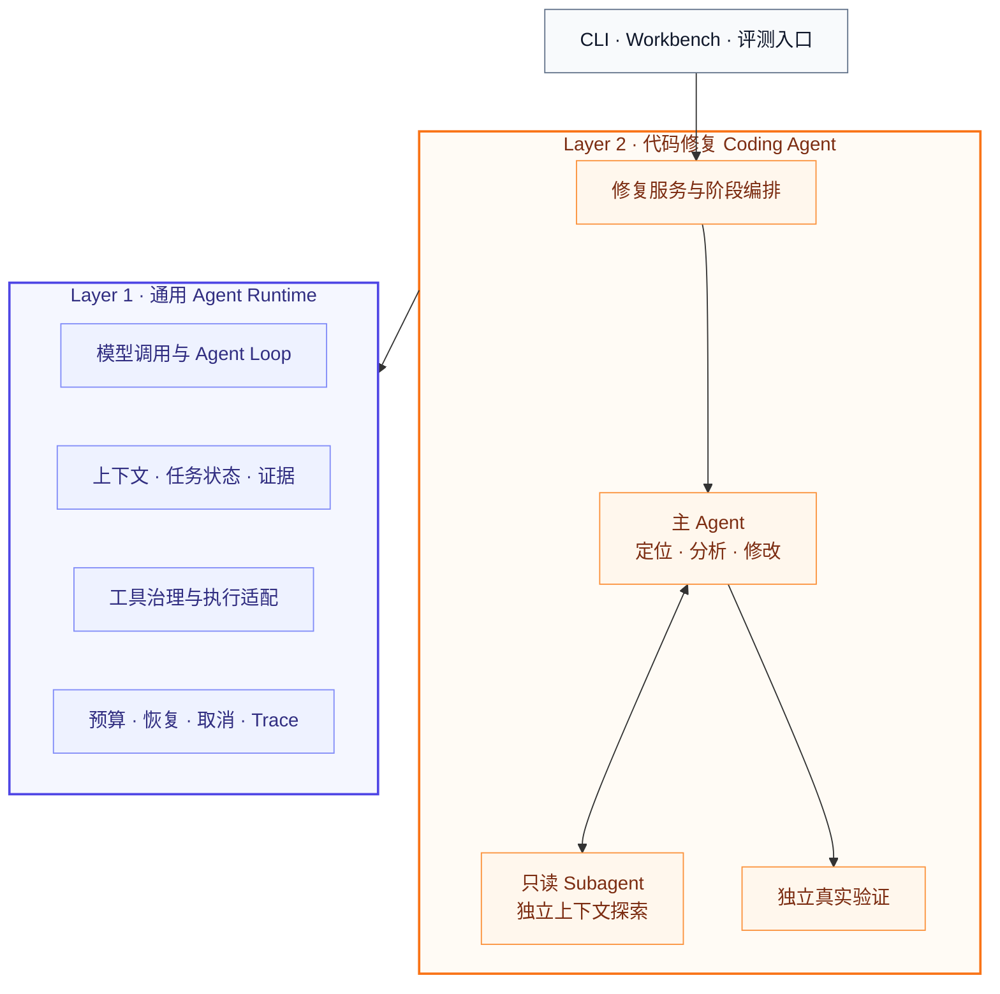
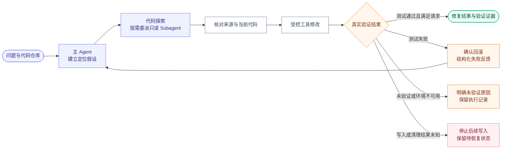
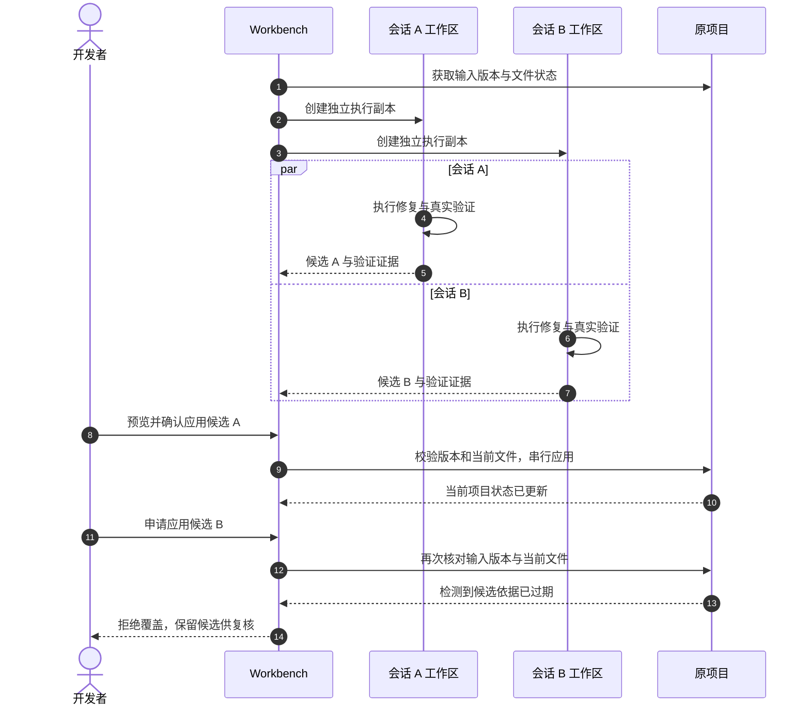

# FixLoop

> 通用 Agent Runtime 与面向代码修复的 Coding Agent。

**从代码探索到真实验证，让长任务的执行、状态与交付有据可查。**

FixLoop 将 Agent 运行内核与代码修复应用分开设计：底层统一管理模型调用、工具执行、上下文、预算和恢复；上层组织问题分析、Subagent 探索、受控修改与真实测试，并通过 Workbench 管理多个项目、工作区和会话。

**个人职责：**独立负责整体架构设计与核心研发，自研通用 Agent Runtime，构建代码修复 Agent 与 Workbench 工作台。

**技术栈：**Python / Pydantic / SQLite / Git Worktree / WSL / bubblewrap / pytest / SSE。

## 运行内核与修复应用

复杂任务需要持续管理目标、证据、工具权限和执行状态。将这些能力集中到 Runtime，使代码修复策略、模型服务与执行后端能够分别演进；普通 Agent 也可以复用相同内核，无需携带修复角色或业务配置。

修复层负责业务阶段、提示、角色策略和完成条件，运行内核负责执行与治理。CLI、工作台和评测调用同一修复服务，避免不同入口各自维护一套修复逻辑。

## 一次修复如何推进

主 Agent 统筹定位、分析与修改，需要时委派只读 Subagent 在独立上下文中探索指定范围，返回带来源的候选发现。任务依赖由 Plan 管理，修改和验证依据实际执行证据推进。

Subagent 的发现需要经过任务范围、来源和工作区有效性检查，主流程复核关键源码后再修改。子任务不继承主会话历史、写权限或递归委派能力；共享预算与取消信号由运行时管理，避免并行探索扩大执行权限或失去成本约束。

补丁通过受治理工具实际落盘，由运行时检查权限、原文与执行结果。是否完成修复由独立验证服务运行真实命令后判定；模型回答中的“已修复”、静态检查或跳过测试，都不能替代满足请求条件的真实测试结果。

## 长任务中的状态、上下文与成本

任务变长后，历史摘要、工具输出和阶段状态容易混在一起。FixLoop 将当前目标、约束、决策与证据单独管理，再为每次模型调用组织所需上下文，使任务推进不依赖一段不断膨胀的聊天历史。

| 需要保持的能力   | 设计取舍                                                                       |
| ---------------- | ------------------------------------------------------------------------------ |
| 任务要求持续有效 | 当前目标、约束和计划状态独立管理，历史摘要不获得修改权威状态的权限             |
| 代码证据能够核对 | 保留来源、内容版本与使用状态，修改后重新判断旧证据是否仍适用                   |
| 上下文预算可控   | 分级压缩、完整交互选择与按需结果展开共同控制输入体量，优先保留必需条件         |
| 辅助调用同样受限 | 规划、提取、摘要与修复共享累计资源账本，分别控制单次容量、调用次数和总截止时间 |
| 外部故障能够收敛 | 重试等待受取消和截止时间约束；预算耗尽、重复调用或无进展时明确停止或收敛执行   |

原始交互与执行记录保留，压缩只形成当前请求的上下文视图。无法完整装入必需信息时阻止调用，避免把缺少关键条件的请求继续交给模型。模型与工具用量进入运行账本，恢复时沿用已记录预算。

## 工具权限与执行恢复

所有动作经过统一 Tool Runtime，完成参数、路径、权限和预算检查，再交给对应执行后端。修改工具检查源文件状态并保留执行依据，多文件提交失败时尝试恢复已完成的修改；结果未确认时停止后续写入。

工作区隔离与命令权限分别管理：Git Worktree 或工作台执行副本用于隔开代码状态，WSL / bubblewrap 后端约束受治理的文件与命令执行。工作台修复在后端不可用时明确失败，避免静默切换成宿主执行。

| 控制能力   | 执行语义                                                                   |
| ---------- | -------------------------------------------------------------------------- |
| Checkpoint | 保存运行身份、任务状态、预算与已确认执行结果，形成可核对的恢复边界         |
| Resume     | 先取得运行所有权，再检查工作区、原资源终态与执行记录；已确认修改不盲目重放 |
| Cancel     | 关闭新调用派发，将取消传递到子任务与执行进程，确认清理和回滚后结束         |
| 权限审批   | 需要授权时保留明确的等待状态，授权后重新核对调用条件                       |
| 未知结果   | 写入、进程退出或清理无法确认时进入待恢复状态，保留现场并阻止冲突操作       |

运行所有权和资源终态分别校验，避免两个恢复请求同时接管同一任务，也避免将一次超时当成进程已退出。宿主执行、工作区隔离与命令沙箱各有边界，不能相互替代。

### 受控的外部资料获取

外部资料获取默认关闭。Patcher 可在宿主明确启用并授权后，通过 Search / Fetch 补充公开文档、版本说明与 Issue。外部访问受独立权限、请求配额、成本和截止时间约束，结果保留来源与不可信标记。

外部资料不能授权本地操作，也不能作为源码已读或测试通过的证据。命令沙箱保持无网络，资料获取经固定宿主适配执行；仓库内容不能自行启用联网能力。

## Workbench：多会话中的候选与代码状态

工作台提供普通聊天、项目只读问答和代码修复入口，以流式事件展示运行进度。项目可以关联多个会话，各次运行使用独立执行副本，候选补丁经差异预览和明确确认后才应用到原项目。

上图示意两个会话基于同一输入各自生成候选的情形。执行状态互不混用，原目录写入串行校验，先前生成的候选不能覆盖后来已更新的代码。

会话树保留分支与祖先关系，编辑早期轮次后从对应输入状态生成新分支，不带入原分支未来的对话和文件结果。浏览器刷新或重新连接可以续看事件，不重复提交任务；文件恢复使用预览和显式确认，发现外部编辑时拒绝直接覆盖。

## Trace 与评测贯穿同一执行链路

以统一运行身份关联模型请求、上下文选择、工具调用、补丁和验证事件，结合阶段耗时、资源消耗和拒绝原因，帮助区分模型决策、证据失效、工具执行与验证环境中的问题。

评测复用正式修复服务，再独立判断输出结果；固定响应模型用于验证编排与工具契约，真实文件修改和测试执行分别记录。答案性资源与实际模型定位、补丁生成路径隔离，避免将离线判分信息带入修复决策。

该设计将运行治理、交互工作台与评测放在一致的执行契约下，使问题既能从结果回溯到过程，也能把改动带回同一链路验证。
