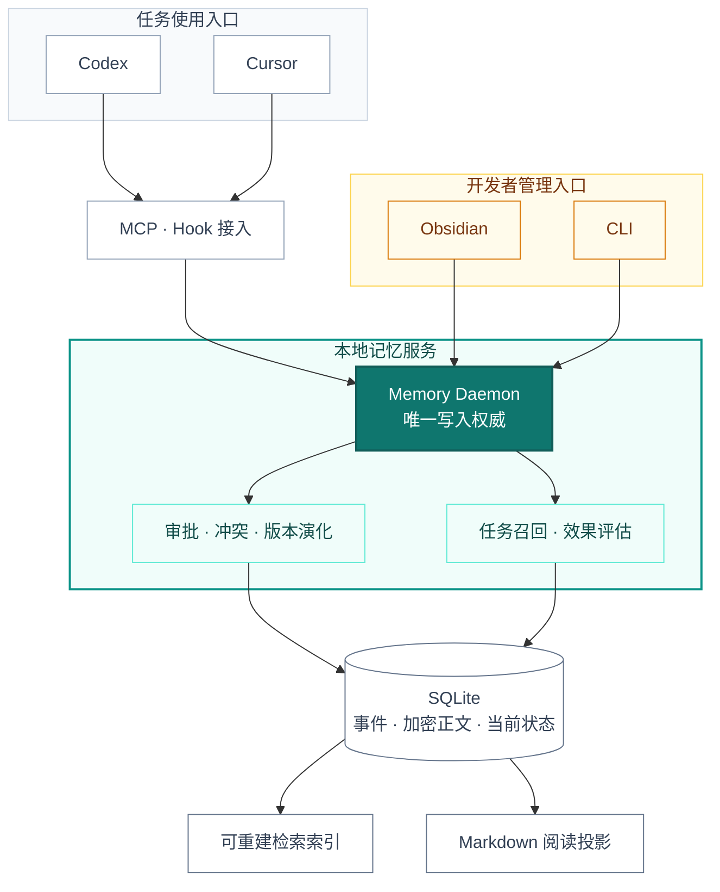
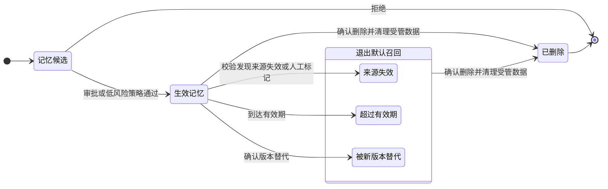
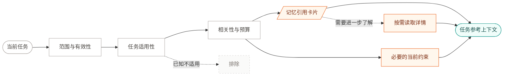

# MemControl

> 由开发者掌控的 Agent 长期记忆。

**本地优先 · 跨客户端复用 · 任务感知 · 可审计治理**

MemControl 为 Codex、Cursor 等 Coding Agent 提供统一的长期记忆服务，将偏好、项目决策和已验证经验带入后续任务。开发者通过 Obsidian 或 CLI 审阅、纠错与删除记忆，Agent 通过 MCP 与 Hook 获取适用于当前任务的参考上下文。

**个人工作：**负责整体架构、核心开发与客户端接入，覆盖记忆写入、任务感知召回、效果评估与生命周期治理。

## 一份记忆，两种使用方式

| Agent 在任务中                 | 开发者在控制面中                   |
| ------------------------------ | ---------------------------------- |
| 获取当前项目适用的约束与经验   | 浏览有效记忆，核对来源、范围和版本 |
| 先读引用卡片，需要时再取详情   | 审阅候选，处理重复、补充与冲突     |
| 提交有来源的记忆候选与使用声明 | 确认纠错、版本替代和删除申请       |
| 提供可关联的任务与验收信息     | 查看效果证据，复核或撤销评估意见   |

> **使用场景示意：**一条项目构建约束发生变化后，开发者审阅并确认新版本。后续客户端在授权范围内读取当前有效记忆，旧版本退出默认召回，历史变更仍可审查。

客户端共享同一份治理状态，记忆是否生效、当前是否适用、能否修改，由统一服务判断。

## 双入口，单一状态权威

Agent 接入与开发者管理分别提供入口，Memory Daemon 统一处理日常读写。客户端不直接访问 SQLite；Obsidian 中的 Markdown 是阅读投影，实际状态由 Daemon 管理。

单写者、请求幂等、版本校验与事务提交共同协调多客户端操作，避免重复请求产生多份记忆，或过期操作覆盖当前状态。多个入口复用同一套权限和治理规则，减少客户端之间的行为分歧。

## 记忆会演化，变更需要留下依据

长期记忆包括稳定偏好、项目约束，也包括有适用条件和有效期的经验。MemControl 用明确的状态、来源与版本关系管理这些差异，让开发者能够判断一条记忆为什么有效、为什么退出召回，以及它被什么取代。

纠错与更新先形成新候选，原记忆在替代获批前保留原有状态。评估建议、实际修改和版本生效分别处理，使变更依据能够被复核。

**写入前的质量治理**覆盖三项判断：

- **保存资格：**核对来源、作用域和审批要求，区分值得长期保留的信息与临时任务内容。
- **敏感风险：**对受支持的敏感类型拒绝保存或提供待确认的安全表达，在持久化前完成处理。
- **内容关系：**结合逻辑身份、结构化事实与已确认的范围内映射识别重复、补充和冲突，保留依据；条件未知时不静默合并或覆盖。

## 将适用的记忆带入当前任务

一条记忆已经生效，并不意味着它适合所有任务。项目范围、目录、工具链、版本条件和有效状态共同决定它是否应当进入当前上下文。已知不适用内容默认排除，条件未知时保留明确标记。

关键词与可选语义检索在合法候选内工作，再按预算组织引用卡片和必要约束正文。需要展开某条记忆时，详情读取会重新检查当前版本与状态，避免在召回后发生的纠错、失效或删除被忽略。记忆始终作为参考信息提供，不能覆盖系统指令。

异步调用、超时取消、缓存与关键词检索降级，使可选模型能力异常时仍可使用基础检索；模型返回较晚时重新核对当前记忆状态，防止旧结果污染新版本。该设计同时关注记忆适用性、上下文开销和服务稳定性。

## 反馈如何成为治理依据

MemControl 分别记录“提供了什么”“观察到了什么”与“验收说明了什么”，并将证据绑定到具体任务、记忆版本和验收条件。

| 观察层次   | 能够说明什么                     | 仍需补充的依据               |
| ---------- | -------------------------------- | ---------------------------- |
| 召回与交付 | 哪些记忆被选中、输出或裁剪       | Agent 是否实际接收、是否采纳 |
| 使用声明   | Agent 声称参考了哪些记忆         | 与声明对应的可观察行为       |
| 行为采纳   | 受支持证据显示记忆与某次选择关联 | 内容是否正确、是否满足验收   |
| 独立验收   | 对应验收项的产物是否符合预期     | 其他影响因素与替代解释       |

受支持的结构化证据通过签名校验和版本绑定检查来源与关联。证据不足、来源错配或存在其他解释时保留不确定结论，不把一次任务成功直接归功于某条记忆。

开发者可以复核、撤销或重新评估意见，历史结论与当前证据状态分别保留。有效反证形成纠错或失效候选，再进入既有治理流程；反馈不直接改写正文或提升可信度。效果加权排序默认关闭，已有评测中的损害反例被保留，用于约束后续应用。

## 删除的范围也需要可核对

删除采用影响范围预览、明确确认和受管数据清理，并检查残留。恢复入口核对删除标记，防止受管恢复重新引入已删除内容。

| 数据范围                                       | 处理方式                           |
| ---------------------------------------------- | ---------------------------------- |
| 受管正文、索引、投影与关联数据                 | 按删除流程清理并验证残留           |
| 变更与删除审计                                 | 仅保留允许的、不含正文的最小元数据 |
| 已交付的历史上下文、操作系统快照与外部备份副本 | 不在本地受管删除的保证范围内       |

## 工程实现

**技术栈：**TypeScript / Node.js / SQLite / MCP / Obsidian Plugin / Vitest / npm Workspaces。

领域规则、应用编排、存储、Daemon 和客户端适配分别组织。事件、正文与派生视图分层管理，使审计、索引重建和受管删除具有明确边界。

项目面向本地单用户、多客户端场景。
