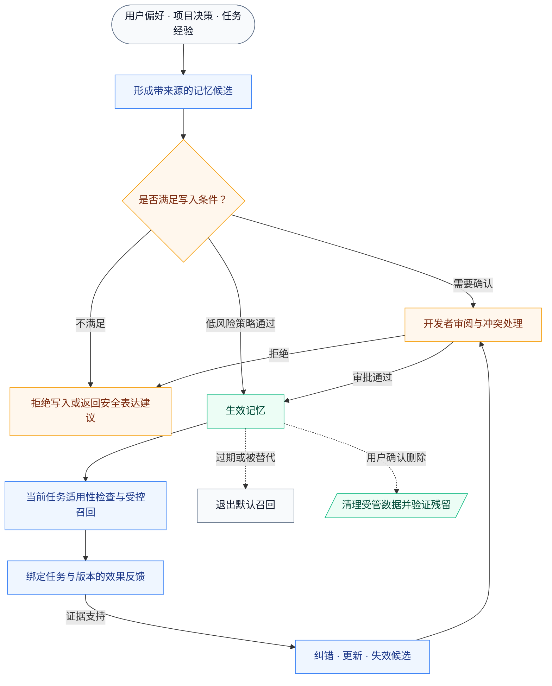
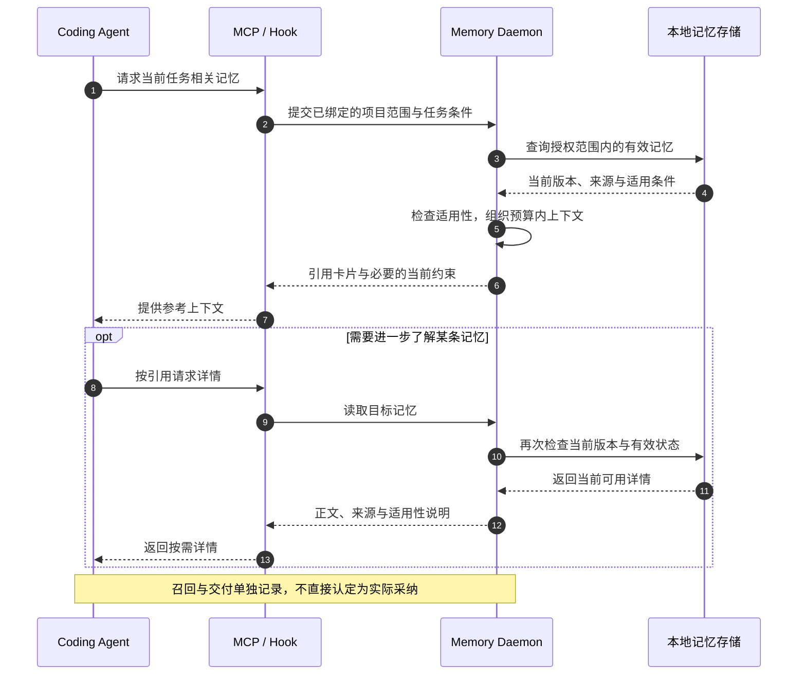
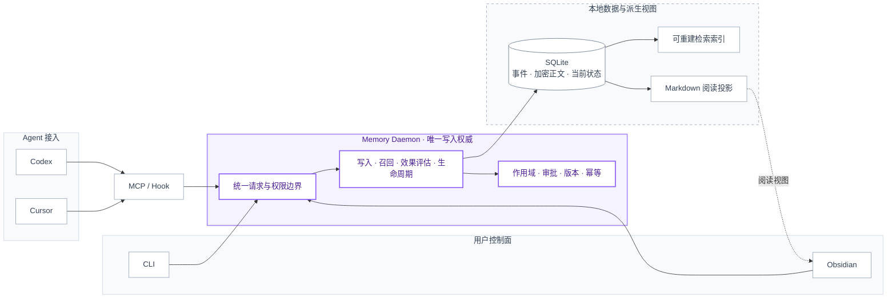

# MemControl

> Coding Agent 长期记忆治理与上下文基础设施：让跨会话、跨客户端的记忆可复用、可审阅、可纠错，并能验证删除结果。

MemControl 是面向 Codex、Cursor 等 Coding Agent 的本地优先长期记忆控制面。项目通过 MCP 与 Hook 接入任务流程，以 Memory Daemon 统一管理记忆写入、召回、反馈和生命周期，通过 Obsidian 提供可视审阅入口，让多个客户端复用同一份由开发者管理的长期记忆。

**个人职责：**负责整体架构、核心开发与客户端接入，构建从记忆候选、任务感知召回到效果评估、版本演化与受管删除的完整治理链路。

**技术栈：**TypeScript / Node.js / SQLite / MCP / Obsidian Plugin / Vitest / npm Workspaces。

## 项目亮点

- **跨客户端 Memory Infra：**将长期偏好、项目决策和已验证经验从客户端中独立出来，通过统一协议与治理规则供多个 Coding Agent 复用。
- **任务感知的上下文供给：**结合项目范围、当前任务与环境条件判断记忆适用性，以引用卡片和按需详情控制上下文预算，避免无差别注入历史信息。
- **可追溯的记忆效果评估：**区分召回、交付、使用声明、实际采纳与独立验收，将反馈绑定到具体任务和记忆版本，减少错误归责与重复计分。
- **一致的生命周期管理：**以单写者、请求幂等和版本校验处理多客户端操作，统一审批、冲突、纠错与删除，并提供可视管理和审计依据。

## 背景与目标

Coding Agent 的长期偏好、项目约束和历史经验容易分散在不同会话与客户端中。记忆一旦过时、冲突或不适用于当前任务，就可能干扰后续决策；自动保存未经确认的结论，也会让错误和敏感信息持续积累。

项目围绕三个问题展开设计：**什么值得记住、何时适合使用、如何持续纠错**。在检索之外增加来源、作用域、审批和版本治理，使记忆既能进入 Agent 的任务上下文，也能由开发者检查、修正和删除。

### 记忆生命周期与治理流程

写入资格、审批策略与实际生效分别管理。自动化负责组织候选与提供证据，纠错、失效和删除沿用各自的权限与确认流程。

## 核心能力与设计思路

### 1. 记忆写入与语义治理：在持久化前控制质量

统一接收用户请求、Agent 提议和任务经验候选，检查来源、作用域、敏感风险与审批要求。对于受支持的敏感类型，在写入前拒绝保存或提供待确认的安全表达，避免将不宜长期保留的信息直接进入存储。

结合逻辑身份、结构化事实与已确认的作用域内映射，区分重复、补充和冲突，保留判断依据与版本关系。语义建议和实际变更分别处理；证据不足或条件未知时保持待核验，避免把相似内容直接合并，或用后写入的结论覆盖旧记忆。

### 2. 任务感知与按需召回：让记忆在合适的条件下进入上下文

先依据作用域、权限、有效状态和当前任务条件筛选适用记忆，再进行关键词与可选语义检索。项目目录、工具链和版本条件参与适用性判断，已知不适用内容默认排除，未知条件保留明确标记。

通过 MCP 与 Hook 提供记忆引用卡片，按需读取详情；已批准且适用的当前约束可以直接提供正文。上下文组织受预算约束，并配套异步调用、超时取消、缓存与关键词检索降级，在记忆复用、上下文开销与服务稳定性之间取得平衡。

引用与详情使用一致的范围和有效性规则，防止先召回、后读取期间的纠错、失效或删除被忽略。记忆始终作为参考信息提供，不能覆盖系统指令。

### 3. 记忆效果评估与反馈：用证据区分“提供过”与“起作用”

将记忆交付、行为采纳与任务验收关联到同一任务、记忆版本和验收条件，区分使用声明、可观察行为与独立验收结果。对于受支持的结构化证据，通过签名校验和版本绑定检查其来源与关联；证据不足、来源错配或存在其他解释时保留不确定结论。

评估支持复核、撤销与重新核验，并保留历史意见和当前证据状态。有效反证可以形成纠错或失效候选，由既有治理流程处理。反馈不直接改写正文或提升可信度；效果加权排序默认关闭，将证据评估与自动应用分开管理。

### 4. 生命周期与可视管理：统一多客户端状态与删除语义

以 Memory Daemon 作为唯一写入权威，统一处理审批、纠错、版本替代、过期与删除。通过单写者、请求幂等、版本校验与事务提交协调多个客户端操作，避免重试产生重复记录，或过期请求覆盖当前状态。

Obsidian 提供记忆浏览、候选审阅、冲突处理和审计入口，CLI 使用相同治理契约。删除前展示影响范围并确认，随后清理受管正文、索引、投影和关联数据，检查残留；恢复入口核对删除标记，防止受管恢复重新引入已删除内容。

## 系统架构与取舍

系统将 Agent 接入、用户管理、治理规则和本地存储分开组织。所有日常读写通过 Daemon，客户端不直接访问 SQLite；Obsidian 中的 Markdown 是阅读投影，实际状态由 Daemon 管理。

| 设计取舍                              | 工程价值                                                         |
| ------------------------------------- | ---------------------------------------------------------------- |
| 多客户端共享 Daemon，保留唯一写入权威 | 将一致性、权限和治理逻辑集中管理，减少客户端之间的状态分歧       |
| 写入审批、召回资格与效果反馈分别判断  | 防止“已保存”被误认为“适合当前任务”，或“被召回”被误认为“内容正确” |
| 事件、正文与派生视图分层管理          | 保留变更依据，支持索引和视图重建，并明确受管删除的清理范围       |
| 异步模型能力与本地基础检索解耦        | 模型超时或不可用时保留关键词检索；迟到结果需重新检查当前记忆状态 |

## 验证结果与适用范围

以下为仓库已有的验收记录，分别说明代码回归、确定性任务和真实客户端验证的范围。

| 验证内容       | 已有结果                                                                                                       |
| -------------- | -------------------------------------------------------------------------------------------------------------- |
| 工程回归       | 最近一次完整验收记录覆盖 **11 个包、536 项测试**及 **36 项脚本测试**，构建与类型检查通过                       |
| 任务适用性     | 完成 **24 个确定性任务配置、96 个执行回执**的自动评测，覆盖适用性判断、按需上下文与反馈策略对照                |
| 真实客户端接入 | Codex MCP、启动 Hook 及独立 Cursor 只读召回已有合成场景验证记录；原 Codex 对照实验覆盖 **9 种条件、18 次运行** |
| 效果与治理     | 隔离验证覆盖交付、采纳、验收、复核及删除；保留正向、负向与不确定结果，检查作用域、版本和证据错配               |

确定性任务和合成客户端实验不代表复杂编码任务中的净收益。评测保留了效果加权的损害反例，因此排序默认关闭；Cursor 写入、Obsidian 原生管理交互及真实编码收益尚未完成相应验收。

项目面向本地单用户、多客户端场景。删除保证覆盖 MemControl 受管数据，不覆盖已交付到历史上下文的内容、操作系统快照或外部备份副本。

## 项目价值

- **让经验跨会话复用：**在多个 Coding Agent 之间共享经过治理的偏好、决策与经验，减少重复提供背景。
- **让上下文更贴近任务：**结合当前条件选择适用记忆，以引用和按需详情控制信息供给。
- **让记忆持续可管理：**将效果反馈、纠错、失效与删除纳入统一流程，减少错误记忆长期积累。
